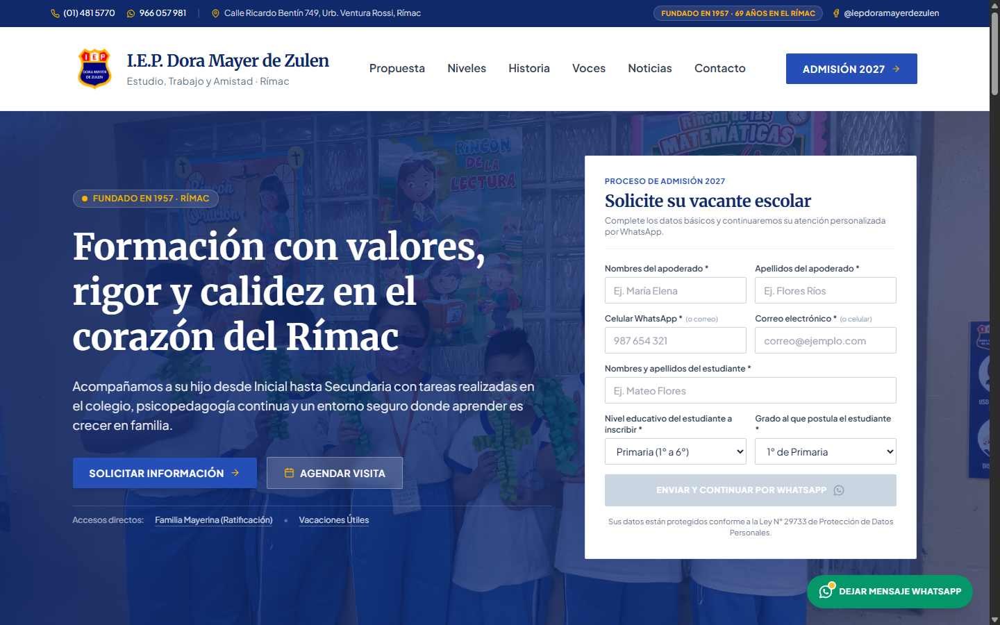
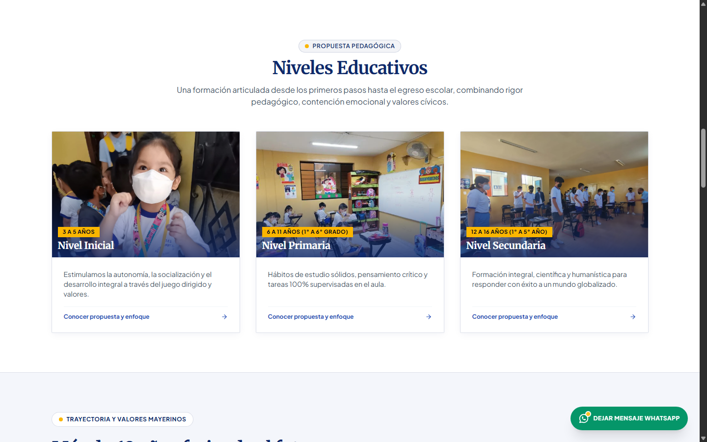
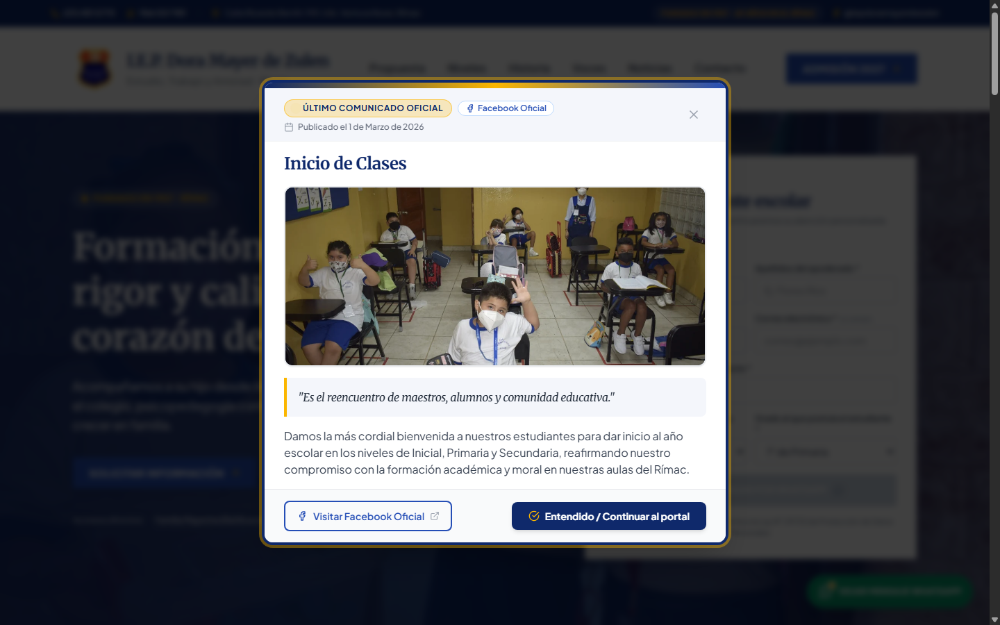
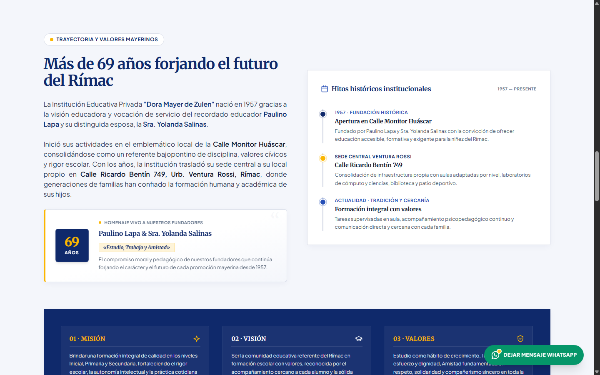
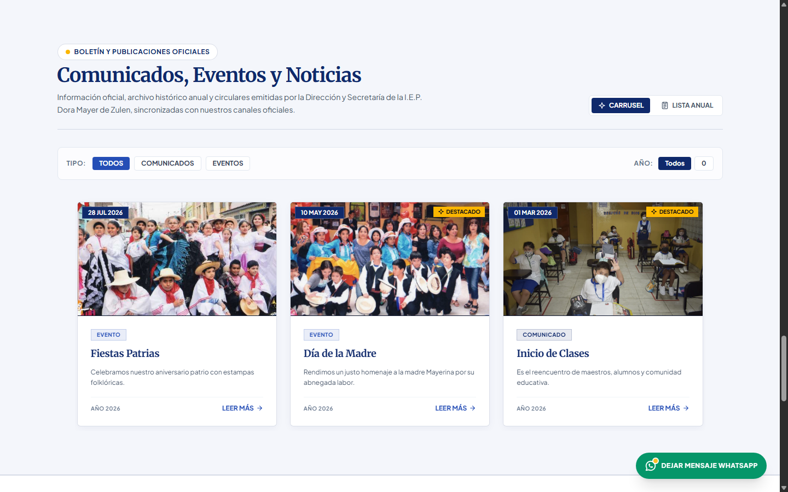

# Institución Educativa Privada "Dora Mayer de Zulen"

<div align="center">

### Institutional Web Portal & School Admissions Platform

[](LICENSE)
[](https://angular.dev/)
[](https://spring.io/projects/spring-boot)
[-ED8B00?style=for-the-badge&logo=openjdk&logoColor=white)](https://openjdk.org/)
[](https://www.mysql.com/)
[](https://tailwindcss.com/)
[](https://www.docker.com/)

**Language / Idioma:**  
🇬🇧 **English** &nbsp;|&nbsp; [🇪🇸 Versión en Español](README_ES.md)

---

</div>

<br>

> **Official Institutional Portal and Admissions System** for **I.E.P. Dora Mayer de Zulen**, founded in 1957 in the district of Rímac, Lima (Peru) by Prof. Paulino Lapa and Mrs. Yolanda Salinas.  
> Institutional Motto: *"Estudio, Trabajo y Amistad"* (Study, Work and Friendship).

---

## 📸 Visual Overview

Here is a visual preview of the platform running with its full content and interactive components:

### 1. Hero Section & Real-time Admissions Form
*Includes institutional branding, authentic historic photography slider, and direct WhatsApp contact integration.*


### 2. Educational Levels (Inicial, Primaria, Secundaria)
*Covers Early Childhood (Inicial), Primary (Primaria), and Secondary (Secundaria) programs with pedagogical badges and classroom insights.*


### 3. Official Announcements & Bulletins Modal
*Featured modal popup highlighting official school notices, academic year opening, and registration schedules.*


### 4. Institutional Heritage & Founders Tribute
*Commemorating over 69 years of history, tributes to founders Prof. Paulino Lapa & Dña. Yolanda Salinas, and core institutional values.*


### 5. School Events & Official News
*Archival calendar and activities featuring genuine school events (Fiestas Patrias, Mother's Day, and Academic Start).*


---

## 🏛️ Institutional Identity & Heritage

- **Foundation:** 1957 (Monitor Huáscar / Jr. Ricardo Bentín 749, Rímac, Lima, Peru).
- **Educational Levels:**
  - **Early Childhood / Initial:** Ages 3 to 5 years.
  - **Primary:** Grades 1st to 6th.
  - **Secondary:** Years 1st to 5th.
- **Official Institutional Colors:**
  - **Institutional Royal Blue:** `#254EB6` / `rgb(37, 78, 182)`
  - **High-Contrast Deep Navy:** `#0F296B` / `rgb(15, 41, 107)`
  - **Mayer Gold:** `#FBB600` / `rgb(251, 182, 0)`
- **Iconography:** Cohesive vector icon system based on `@outline/outline-icons` (zero decorative emojis in UI).

---

## 🚀 Technical Architecture

### Frontend (SPA)
- **Framework:** Angular 18 (Signals-based reactive state, Control Flow syntax `@if/@for`, `@defer` viewport rendering with placeholders for Zero Cumulative Layout Shift).
- **Styling:** Tailwind CSS with customized institutional theme (`tailwind.config.js`).
- **Interactive Components:**
  - Hero Slider featuring 12 historical photos preserved from Wayback Machine archives.
  - Infinite auto-rotating testimonial carousel with hover pause and touch-drag support.
  - Real-time client-side form validation for ID (DNI), phone numbers, and admission inquiries.

### Backend (REST API)
- **Framework:** Spring Boot 3.3.4 running on Java 21 LTS with native **Virtual Threads** (Project Loom).
- **Architecture:** Hexagonal Architecture / Ports & Adapters isolating Domain, Application, and Infrastructure layers.
- **Security & Reliability:** IP-based rate limiting (Token Bucket filter), strict CORS policies, and Bean Validation (JSR-380).
- **Persistence:** Spring Data JPA + Hibernate with MySQL 8.3 / compatible relational engines.
- **Caching:** In-memory Caffeine Cache for announcements, events, and static institutional catalogs.

---

## 🛠️ Local Execution (Docker Compose)

The complete stack (MySQL database, Spring Boot backend API, and Angular SPA served via Nginx) can be started with a single command:

```bash
# 1. Build and start all containers in detached mode
docker compose up -d --build

# 2. Verify container health status
docker compose ps
```

### Access Points

| Service | URL / Port | Description |
| :--- | :--- | :--- |
| **Frontend Portal** | [http://localhost:4200](http://localhost:4200) | Angular 18 Single Page Application |
| **Backend API Health** | [http://localhost:8081/actuator/health](http://localhost:8081/actuator/health) | Spring Boot Actuator health endpoint |
| **MySQL Database** | `localhost:3306` | Relational database (schema initialized automatically) |

> [!NOTE]
> Default credentials for local development are managed through environment variables in `docker-compose.yml`. For custom configurations, adjust environment variables securely without exposing production secrets.

---

## 📄 License

This project is licensed under the **MIT License**. See the [LICENSE](LICENSE) file for details.
