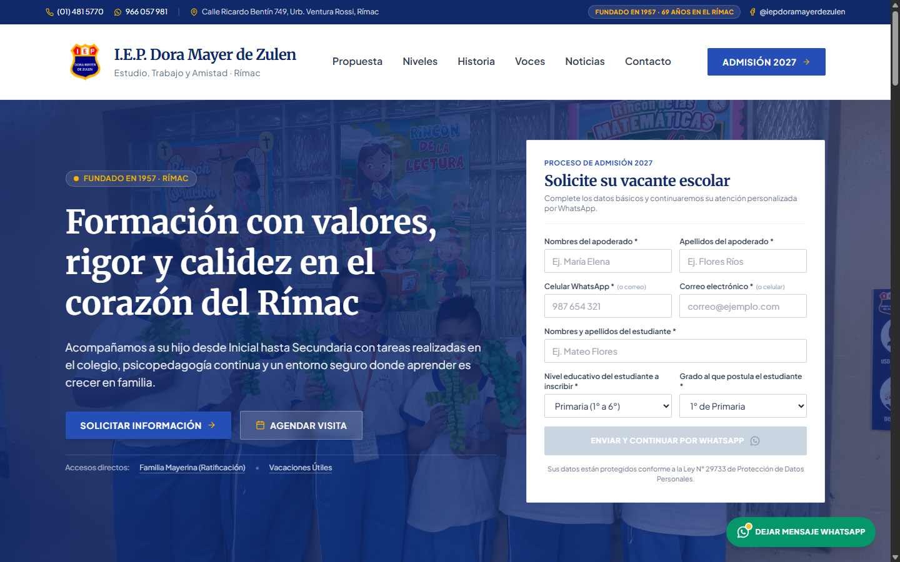
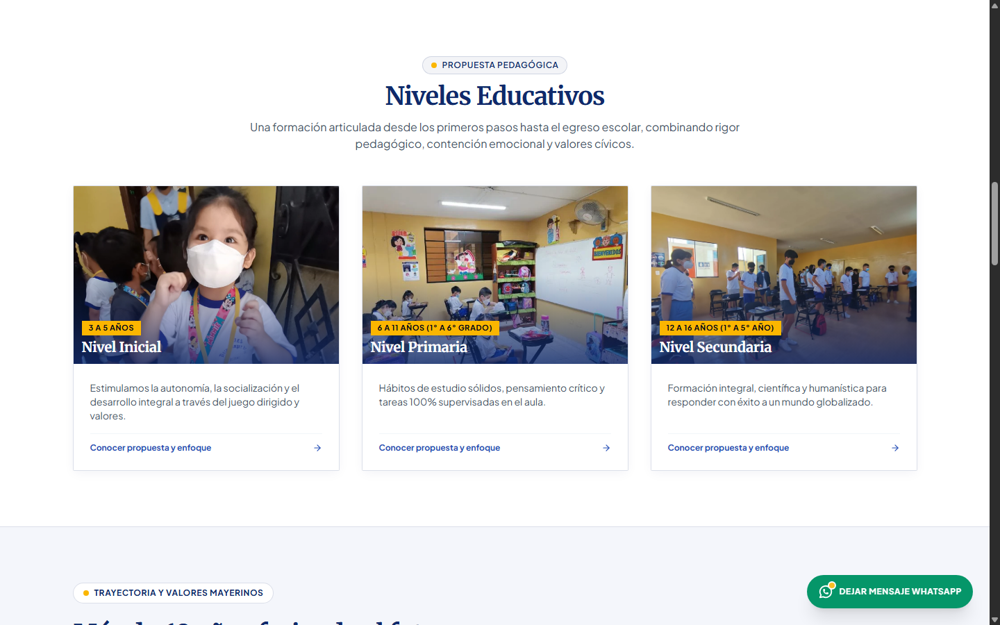
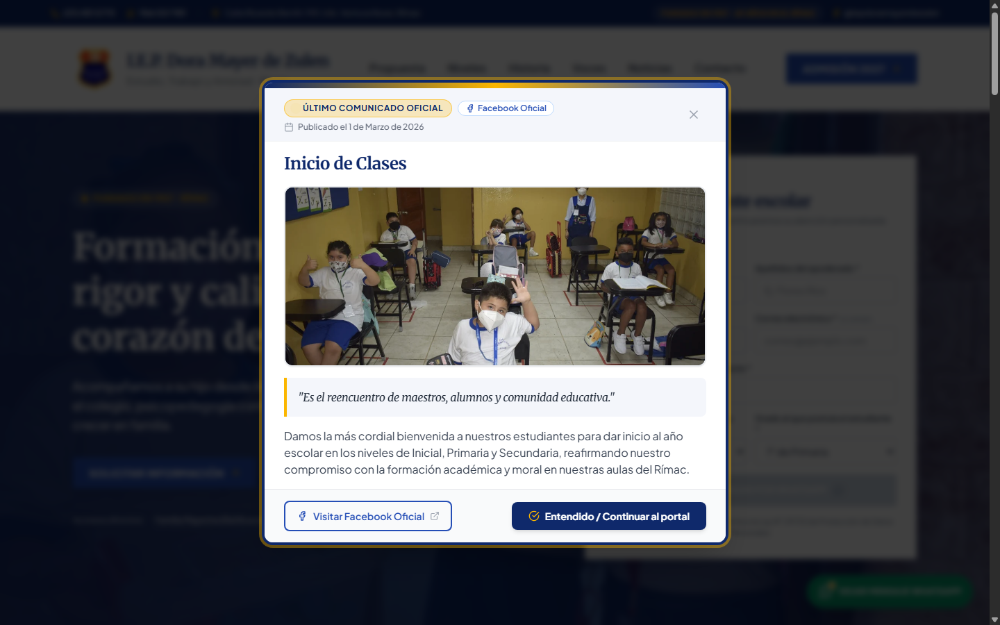
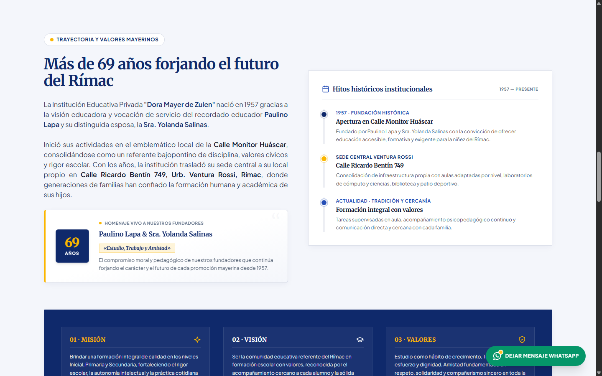
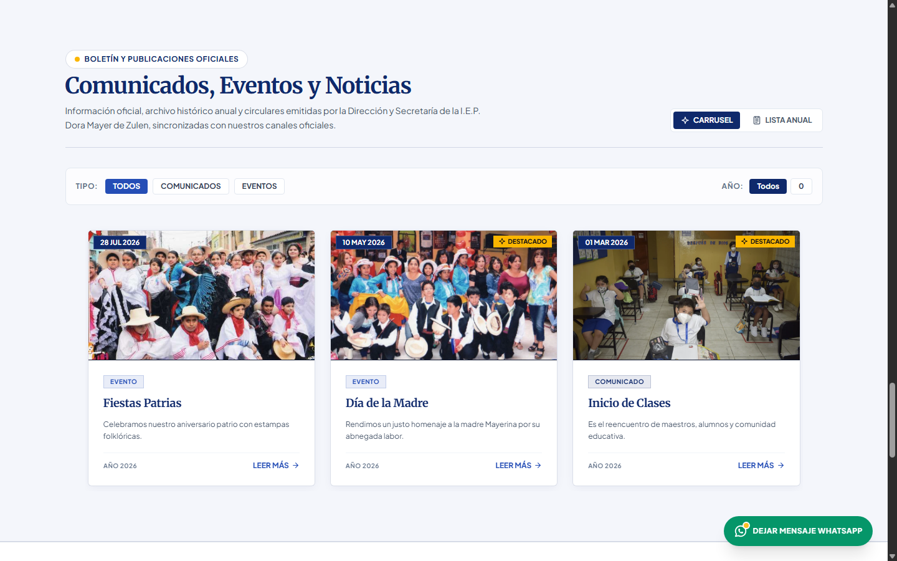

# Institución Educativa Privada "Dora Mayer de Zulen"

<div align="center">

### Portal Web Institucional y Plataforma de Admisión Escolar

[](LICENSE)
[](https://angular.dev/)
[](https://spring.io/projects/spring-boot)
[-ED8B00?style=for-the-badge&logo=openjdk&logoColor=white)](https://openjdk.org/)
[](https://www.mysql.com/)
[](https://tailwindcss.com/)
[](https://www.docker.com/)

**Language / Idioma:**  
[🇬🇧 English Version](README.md) &nbsp;|&nbsp; 🇪🇸 **Español**

---

</div>

<br>

> **Portal Web Oficial y Sistema de Admisión y Gestión Escolar** de la **I.E.P. Dora Mayer de Zulen**, fundada en 1957 en el distrito del Rímac por el Prof. Paulino Lapa y Dña. Yolanda Salinas.  
> Lema institucional: *"Estudio, Trabajo y Amistad"*.

---

## 📸 Resumen Visual

Vistas previas del portal con todo su contenido multimedia y componentes interactivos activos:

### 1. Sección Principal (Hero) y Formulario de Admisión
*Cabecera institucional, carrusel de fotografías históricas y formulario de solicitud de vacantes conectado a WhatsApp.*


### 2. Niveles Educativos (Inicial, Primaria, Secundaria)
*Propuesta pedagógica articulada para Inicial, Primaria y Secundaria con fotografías reales de actividades en aula.*


### 3. Modal de Comunicados y Novedades Oficiales
*Modal emergente para anuncios de secretaría, cronogramas de matrícula y circulares de inicio de clases.*


### 4. Historia Institucional y Homenaje a los Fundadores
*Más de 69 años de trayectoria en el Rímac, homenaje a los fundadores Paulino Lapa y Sra. Yolanda Salinas, y principios institucionales.*


### 5. Eventos Escolares y Publicaciones Oficiales
*Muro interactivo de noticias y actividades oficiales (Fiestas Patrias, Día de la Madre e Inicio de Clases).*


---

## 🏛️ Identidad y Fidelidad Institucional

- **Fundación:** 1957 (Monitor Huáscar / Jr. Ricardo Bentín 749, Rímac, Lima - Perú).
- **Niveles Educativos:** Inicial (3 a 5 años), Primaria (1° a 6° grado) y Secundaria (1° a 5° año).
- **Paleta Oficial Mayerina:**
  - **Royal Blue Institucional:** `#254EB6` / `rgb(37, 78, 182)`
  - **Deep Navy de Alto Contraste:** `#0F296B` / `rgb(15, 41, 107)`
  - **Dorado / Oro Mayerino:** `#FBB600` / `rgb(251, 182, 0)`
- **Iconografía:** Sistema unificado y riguroso basado en `Outline Icons` (`@outline/outline-icons`). Cero emojis en la interfaz de usuario.

---

## 🚀 Arquitectura Tecnológica

### Frontend (SPA)
- **Framework:** Angular 18 (Arquitectura basada en `Signals`, Control Flow `@if/@for`, componentes `@defer` on viewport con placeholders para Zero Cumulative Layout Shift).
- **Estilos:** Tailwind CSS con configuración institucional personalizada (`tailwind.config.js`).
- **Componentes e Interacciones:**
  - Hero Slider rotacional con las 12 fotos históricas originales del colegio rescatadas del archivo histórico.
  - Testimonios con carrusel infinito rotacional, pausado por hover y navegación táctil (drag & swipe).
  - Validación en tiempo real de DNI, teléfono y formulario de admisión.

### Backend (REST API)
- **Framework:** Spring Boot 3.3.4 sobre Java 21 LTS con soporte nativo de **Virtual Threads** (Project Loom).
- **Arquitectura:** Arquitectura Hexagonal / Puertos y Adaptadores con separación estricta de Dominio, Aplicación e Infraestructura.
- **Seguridad:** Rate limiting por IP (filtro token bucket), CORS restrictivo, sanitización y validación Bean Validation (JSR-380).
- **Persistencia:** Spring Data JPA + Hibernate contra base de datos MySQL 8.3.
- **Caché:** Caffeine Cache en memoria para eventos, comunicados y catálogos estáticos.

---

## 🛠️ Ejecución Local con Docker Compose

Para levantar el entorno completo (Base de Datos MySQL, Backend Spring Boot y Frontend Angular + Nginx):

```bash
# Iniciar todos los contenedores en segundo plano
docker compose up -d --build

# Verificar el estado de salud de los contenedores
docker compose ps
```

### Puntos de Acceso

| Servicio | URL / Puerto | Descripción |
| :--- | :--- | :--- |
| **Frontend Portal** | [http://localhost:4200](http://localhost:4200) | Aplicación SPA en Angular 18 |
| **Backend API Health** | [http://localhost:8081/actuator/health](http://localhost:8081/actuator/health) | Endpoint de verificación Spring Boot Actuator |
| **Base de Datos MySQL** | `localhost:3306` | Base de datos relacional (esquema inicializado automáticamente) |

> [!NOTE]
> Las credenciales de desarrollo local están parametrizadas en `docker-compose.yml` para facilitar la puesta en marcha. En entornos de producción, utilice variables de entorno seguras.

---

## 📄 Licencia

Este proyecto se distribuye bajo los términos de la **Licencia MIT**. Consulte el archivo [LICENSE](LICENSE) para más información.
